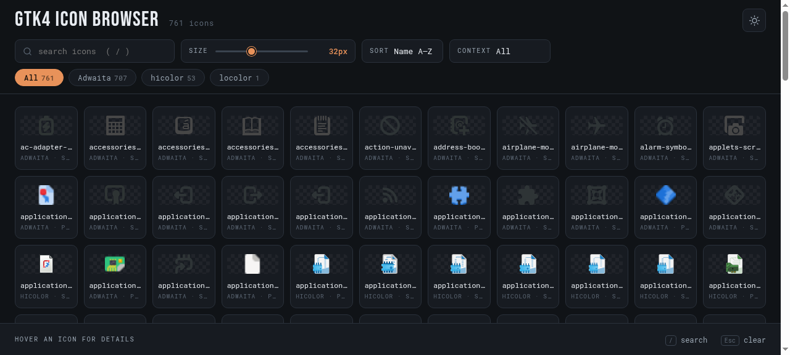

# Icon Browser

[](https://github.com/nativeit/gtk4-icon-browser/tree/dev)
[](LICENSE.md)

A single-file, dependency-free showcase for the icon themes and icon folders
on your machine — on Linux, macOS or Windows. Point it at any folder of
icons (or your installed system themes) and get a filterable, searchable,
size-adjustable grid of every icon, with one-click copy of each icon's name
and an optional QR-code webshare for your phone.



## Why

Icon sets are documented poorly. When you're building an app, a website or a
custom icon theme, you mostly want to answer: *what's installed, what does it
look like, and what is it called?* This answers that with one plain HTML
page — no build step, no runtime, no server required.

## Features

- **Any icon source** — system theme directories (`/usr/share/icons` on
  Linux, macOS CoreTypes) or any folder you choose; on Windows, point it at
  any folder of `.png` / `.svg` / `.ico` files
- **Common formats rendered** — SVG, PNG and ICO natively in the browser;
  macOS `.icns` files are converted with the built-in `sips` tool; Linux
  `.xpm` files convert via ImageMagick when available
- **Size slider** — snaps to standard icon sizes (16 / 22 / 24 / 32 / 48 /
  64 / 96 / 128 / 256)
- **Search, filter, sort** — by name, source folder/theme (chips with
  counts), and context (`actions`, `devices`, `status`, …)
- **Hover/tap inspector** — name, theme, context, all available size
  variants, formats, and the full file path
- **Copy button on every card** — copies the icon's name (filename minus
  extension); `/` jumps to search
- **Mobile-friendly layout** — responsive controls, swipeable filter chips,
  44px touch targets, tap-to-select on phones
- **QR webshare (optional)** — a tiny local webserver publishes the showcase
  to your local network; open the connect page on any desktop and scan the
  QR with a phone. Same-origin serving means no CORS issues, and directory
  listings are disabled
- **Light & dark modes** — persisted between visits
- **Fully self-contained** — self-hosted subset fonts, no CDN, no JS
  framework

## Install

**Linux / macOS**

```bash
git clone https://github.com/nativeit/gtk4-icon-browser.git
cd gtk4-icon-browser
bash install.sh
```

**Windows (PowerShell)**

```powershell
git clone https://github.com/nativeit/gtk4-icon-browser.git
cd gtk4-icon-browser
powershell -ExecutionPolicy Bypass -File install.ps1
```

The installers ask before doing anything irreversible and never require
admin rights. Default install is a visible `~/icon-browser` (sandboxed
browsers can't read hidden paths). Custom scan folders and install locations
are supported — hidden or system-owned destinations get an extra
confirmation.

Uninstall any time:

```bash
bash install.sh --uninstall                # Linux / macOS (alias: --remove)
powershell -File install.ps1 -Uninstall    # Windows
```

See [QUICKSTART.md](QUICKSTART.md) for the two-minute version.

## Documentation

| Doc | Contents |
|-----|----------|
| [QUICKSTART.md](QUICKSTART.md) | install, launch, webshare, uninstall — the short path |
| [DEVELOPMENT.md](DEVELOPMENT.md) | project structure, technical details, versioning |
| [LICENSE.md](LICENSE.md) | MIT license + bundled font licenses |

## Status

This is a casual side project: it does what it says, and there's no real
plan to grow it beyond that. That said, contributions are welcome — see
[DEVELOPMENT.md](DEVELOPMENT.md) for how the project is organized.

## License

[MIT](LICENSE.md) — Native IT © 2026. Bundled fonts are licensed separately
(SIL OFL 1.1 / MIT) — see [LICENSE.md](LICENSE.md).